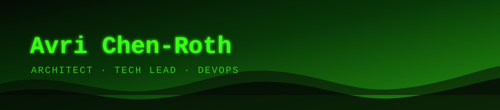

  

  &nbsp;&nbsp;
  &nbsp;&nbsp;

 

Hello 👋 I'm Avri — architect, tech lead and DevOps engineer. Yesterday's clever architecture is today's on-call rotation, so I plan accordingly 📟

  

- [the-mentor/cbox](https://github.com/the-mentor/cbox) (today)
  - Run a coding agent like claude-code in a micro VM sandbox
- [the-mentor/homeassistant-addons](https://github.com/the-mentor/homeassistant-addons) (6 days ago)
  - 
- [the-mentor/no-ai-attribution](https://github.com/the-mentor/no-ai-attribution) (4 weeks ago)
  - Hook plugin for Claude Code, Codex CLI, Copilot CLI, and Qoder that blocks AI attribution (Co-Authored-By trailers, &#34;Generated with&#34; footers) in git commits, PRs, and issues.
- [the-mentor/DJIamControllerBridge](https://github.com/the-mentor/DJIamControllerBridge) (2 months ago)
  - This to bridge your DJI controller to Drone Simulator
- [the-mentor/RDPie](https://github.com/the-mentor/RDPie) (2 months ago)
  - RDP Server for macOS 

- [feat: environment variables in profiles](https://github.com/the-mentor/cbox/pull/154) on [the-mentor/cbox](https://github.com/the-mentor/cbox) (today)
- [docs: document stored secrets and profiles in the README](https://github.com/the-mentor/cbox/pull/150) on [the-mentor/cbox](https://github.com/the-mentor/cbox) (today)
- [fix: keep just up, exec, down, list and up-dev arguments whole](https://github.com/the-mentor/cbox/pull/148) on [the-mentor/cbox](https://github.com/the-mentor/cbox) (today)
- [fix: secret create, edit and delete print help when run without arguments](https://github.com/the-mentor/cbox/pull/146) on [the-mentor/cbox](https://github.com/the-mentor/cbox) (today)
- [feat: profiles (cbox profile, cbox up --profile)](https://github.com/the-mentor/cbox/pull/145) on [the-mentor/cbox](https://github.com/the-mentor/cbox) (today)

- [the-mentor/cbox](https://github.com/the-mentor/cbox) ([v0.1.26](https://github.com/the-mentor/cbox/releases/tag/v0.1.26), today)
  - Run a coding agent like claude-code in a micro VM sandbox
- [kagent-dev/kagent](https://github.com/kagent-dev/kagent) ([v1.0.0-rc3](https://github.com/kagent-dev/kagent/releases/tag/v1.0.0-rc3), 2 days ago)
  - Cloud Native Agentic AI | Discord: https://bit.ly/kagentdiscord
- [terrateamio/action](https://github.com/terrateamio/action) ([v1.3.4](https://github.com/terrateamio/action/releases/tag/v1.3.4), 3 days ago)
  - Terrateam Action
- [omnigent-ai/omnigent](https://github.com/omnigent-ai/omnigent) ([v0.21.0](https://github.com/omnigent-ai/omnigent/releases/tag/v0.21.0), 3 days ago)
  - Omnigent is an open-source AI agent framework and meta-harness: orchestrate Claude Code, Codex, Cursor, Pi, and custom agents — swap harnesses without rewriting, enforce policies and sandboxing, and collaborate in real time from any device.
- [the-mentor/no-ai-attribution](https://github.com/the-mentor/no-ai-attribution) ([v0.2.12](https://github.com/the-mentor/no-ai-attribution/releases/tag/v0.2.12), 4 weeks ago)
  - Hook plugin for Claude Code, Codex CLI, Copilot CLI, and Qoder that blocks AI attribution (Co-Authored-By trailers, &#34;Generated with&#34; footers) in git commits, PRs, and issues.

- [phantomptr/ps5upload](https://github.com/phantomptr/ps5upload) (1139)
  - Send games, apps and homebrew to a jailbroken PS5, and manage the console from your computer, phone or browser.
- [NotProtonNot/NotProton](https://github.com/NotProtonNot/NotProton) (2464)
  - Steam Play for macOS
- [idanbenzvi/abc-letter-quest](https://github.com/idanbenzvi/abc-letter-quest) (1)
  - A 3D phonics/flight game — collect letters, fly an albatross, learn the ABCs
- [the-mentor/no-ai-attribution](https://github.com/the-mentor/no-ai-attribution) (4)
  - Hook plugin for Claude Code, Codex CLI, Copilot CLI, and Qoder that blocks AI attribution (Co-Authored-By trailers, &#34;Generated with&#34; footers) in git commits, PRs, and issues.
- [Devolutions/IronRDP](https://github.com/Devolutions/IronRDP) (3285)
  - Rust implementation of the Microsoft Remote Desktop Protocol (RDP)

